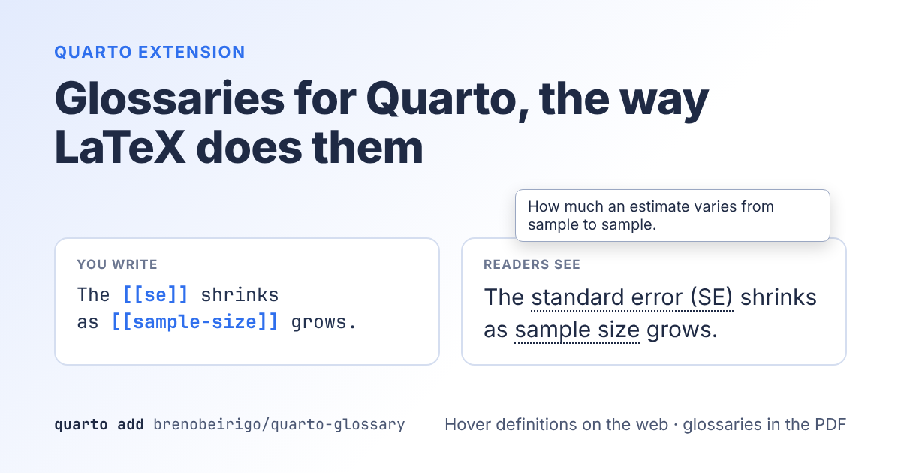

# Quarto Glossary

[](https://github.com/brenobeirigo/quarto-glossary/actions/workflows/checks.yml)

Glossaries and acronym lists for Quarto, the way LaTeX's `glossaries` package
does them. Write `[[key]]` in your text. Web readers get a definition balloon
on hover or keyboard focus. The PDF gets native `\gls{key}` entries. The first
use of an acronym expands it, later uses abbreviate it, and the lists at the
end contain exactly the entries you cited.

**[Manual, live demo, and comparison with other tools](https://brenobeirigo.github.io/quarto-glossary/)**



- Terms in the document's front matter, in one YAML or JSON file, or in
  several files.
- Accessible HTML balloons that callouts, tables, and captions cannot clip.
- Separate Acronyms and Glossary lists in HTML and LaTeX.
- `glossaries-extra` or `glossaries`, with `noidx`, `makeindex`, or `bib2gls`.
- Strict mode: an unknown key stops the render, which keeps human and
  AI-agent drafts on a fixed vocabulary.
- No R, Python, or JavaScript dependencies. Requires Quarto 1.4 or newer.

## Install

Run this in the root of each Quarto project:

```bash
quarto add brenobeirigo/quarto-glossary
```

Quarto copies the extension into `_extensions/brenobeirigo/glossary`. Commit
that directory so every build uses the same version. `quarto list extensions`
shows the installed version.

## Basic use

Terms can live in the document itself:

```markdown
---
title: First glossary
filters: [glossary]
glossary:
  entries:
    - id: adp
      kind: acronym
      short: ADP
      long: approximate dynamic programming
      definition: Methods that approximate downstream value.
---

The [[adp]] policy is evaluated. Later, [[adp]] is abbreviated.

::: {.glossary}
:::
```

Or in a file shared by several documents, set in a document or in
`_quarto.yml`:

```yaml
filters: [glossary]
glossary:
  path: glossary.yml          # or a list: [terms.yml, acronyms.yml]
```

`path` and `entries` can be combined. A key defined twice stops the render and
names both sources. In a website or book, a page's own `glossary:` block
replaces the one in `_quarto.yml`, so repeat the options that page still
needs.

The `::: {.glossary}` placeholder prints the lists. Terms and acronyms render
into separate Glossary and Acronyms sections, and empty sections are omitted.
The placeholder accepts custom labels, anchors, and `include-unused`:

```markdown
::: {#terms .glossary title="Terms" acronym-title="Abbreviations" acronym-id="abbreviations" level="2"}
:::
```

In headings, wiki links resolve to plain text. They count as uses but do not
create nested links, first-use side effects, or definition styling in website
sidebars and tables of contents. Body references retain definitions and links.

## Reference forms

The alias position can select a semantic form:

| Markup | Meaning |
|---|---|
| `[[key]]` | Automatic singular form; acronyms expand on first use |
| `[[key\|plural]]` | Automatic plural form; acronyms expand on first use |
| `[[key\|short]]` | Acronym short form |
| `[[key\|long]]` | Acronym long form |
| `[[key\|full]]` | Acronym long and short forms |
| `[[key\|short-plural]]` | Explicit short plural |
| `[[key\|long-plural]]` | Explicit long plural |
| `[[key\|full-plural]]` | Explicit full plural |
| `[[key\|text]]` | Entry's configured text form |
| `[[key\|first]]` | Entry's configured first-use form |
| `[[key\|symbol]]` | Associated symbol |
| `[[key\|cap:plural]]` | Capitalized version of any semantic form |
| `[[key\|capitalized]]` | Capitalized automatic singular form |
| `[[key\|custom text]]` | Literal custom display text |
| `[[key\|=plural]]` | Literal text that would otherwise name a form |

Semantic forms generate native `\gls`, `\glspl`, `\Gls`, or `\Glspl` calls
where state matters. Explicit and custom forms remain indexed and linked but
do not consume the acronym's first-use state.

## Vocabulary data

YAML and JSON are supported. Definitions and symbols accept Markdown,
citations, emphasis, links, and mathematics:

```yaml
entries:
  - id: decision-epoch
    term: decision epoch
    text: decision epoch
    plural: decision epochs
    first: decision epoch
    first-plural: decision epochs
    symbol: $t$
    definition: A **time point** at which state $S_t$ is observed [@source].
    tooltip: A time point at which the system state is observed.
    sort: decision epoch
    see: fleet-management
    see-also: adp

  - id: adp
    kind: acronym
    short: ADP
    long: approximate dynamic programming
    short-plural: ADP methods
    long-plural: approximate dynamic programming methods
    definition: Methods that approximate downstream value [@source].
    tooltip: Methods that approximate downstream value.
```

Terms require `id`, `term`, and `definition`. Acronyms require `id`,
`kind: acronym`, `short`, and `long`; `definition` supplies the richer acronym
list description. When omitted, regular plurals are formed by appending `s`,
so academic documents should explicitly set irregular or stylistically
preferred plurals. `see` and `see-also` accept a key or comma-separated/YAML
list of keys and are validated during rendering.

For migration, `key` or `label` aliases `id`; `name` aliases `term`;
`description` aliases `definition`; `abbreviation` or `acronym` aliases
`short`; and `expansion` aliases `long`. A `terms` list or `groups[].rows`
also works in place of `entries`.

Balloons are plain text. Parenthetical citations are dropped from them and
kept in the generated lists. Set a short `tooltip` when the definition is long.

If definitions contain citations, configure the document's normal
`bibliography`. The filter uses Pandoc's citation processor for LaTeX header
definitions and inserts native citation nodes into HTML glossary content.

## Options

```yaml
glossary:
  path: glossary.yml               # file, list of files, or false
  entries: []                      # entries written in the metadata
  strict: true
  include-unused: false
  link: true
  html-definition-display: balloon  # balloon | tooltip
  title: Glossary
  acronym-title: Acronyms
  heading-level: 1
  html-glossary-page: ""          # page holding the lists, for websites

  latex-load-package: true
  latex-package: glossaries-extra  # glossaries-extra | glossaries
  latex-backend: noidx             # noidx | makeindex | bib2gls
  latex-location-lists: false
  latex-sort: word                 # word | letter | case | def | use
  latex-style: ""                  # e.g. altlist
  acronym-style: long-short-desc
  bib2gls-file: ""                 # optional generated database path
```

`html-definition-display: balloon` is the default. It shows the definition in
a styled balloon on hover or keyboard focus and omits the HTML `title`
attribute so Quarto cannot show a second tooltip. Select `tooltip` to use the
title-based Quarto/browser surface instead; the balloon helper is then omitted.
The bundled helper places the visual balloon at document-body level, so
callouts, table cells, captions, and responsive overflow containers cannot
clip it or lose their own scrolling behavior.

`html-glossary-page` is for websites and books whose Glossary and Acronyms
lists live on one page. Set it to that page, for example `glossary.qmd`, and a
reference on any other page links to the entry there. A page that contains a
`.glossary` placeholder keeps linking within the page. Give the glossary page
a `::: {.glossary include-unused="true"}` placeholder to list every entry.
References only become links when their entry exists on the page or on the
glossary page; elsewhere they stay focusable terms with a balloon.

`glossaries-extra` is the default because it supports per-category acronym
styles and `see-also`. The extension explicitly selects `long-short-desc`, so
acronyms use “long form (SHORT)” on first use rather than the package's
short-only acronym default. Set `latex-package: glossaries` for the base
package; `see-also` then intentionally fails because that key is an
extra-package feature.

`latex-location-lists: true` retains page/location references. Leave it false
for compact journal-style lists. Because LaTeX cross-references such as “see
also” live in the location list, enable location lists when those relations
must appear in PDF.

## LaTeX backends

| Backend | Best fit | Build |
|---|---|---|
| `noidx` | Articles and portable projects | Ordinary `quarto render ... --to pdf` |
| `makeindex` | Conventional theses/books and publisher toolchains | LaTeX, `makeglossaries`, LaTeX twice |
| `bib2gls` | Large or multilingual vocabularies and Unicode-aware sorting | LaTeX, `bib2gls`, LaTeX twice |

`noidx` is the default and needs no external indexing command. Quarto performs
the repeated LaTeX runs automatically.

For `makeindex`, first produce LaTeX and then run the indexer:

```console
quarto render paper.qmd --to latex
lualatex paper.tex
makeglossaries paper
lualatex paper.tex
lualatex paper.tex
```

For `bib2gls`, the filter generates `_quarto-glossary-paper.bib` from the
portable YAML/JSON vocabulary:

```console
quarto render paper.qmd --to latex
lualatex paper.tex
bib2gls paper
lualatex paper.tex
lualatex paper.tex
```

Install advanced tools through TeX Live when necessary:

```console
tlmgr install glossaries glossaries-extra bib2gls
```

`latex-sort: word` uses TeX word sorting with `noidx`; with `bib2gls` it uses
the document/JVM locale. `letter`, `case`, `def`, and `use` map to bib2gls's
`letter-nocase`, `letter-case`, `none`, and `use` methods respectively.

## Examples and verification

- `example.qmd` exercises terms, acronyms, first use, semantic reference
  forms, plurals, a symbol, Markdown, mathematics, citations, related terms,
  HTML definition balloons, and separate output lists.
- `website-example/` demonstrates balloons in prose, callouts, table cells,
  and captions while verifying that heading markup never changes Quarto TOC
  alignment.
- `docs/` contains the source of the public manual. `docs/demos/front-matter.qmd`
  is a lesson whose entries live only in its front matter, rendered to HTML
  and PDF.

```console
quarto render example.qmd --to html
quarto render example.qmd --to latex
quarto render example.qmd --to pdf
quarto render website-example
python -m unittest discover -s tests -v
```

The test suite builds actual PDFs with all three backends when their tools are
available. The extension follows Quarto's distribution layout and can be
installed directly from this repository root.

## License

MIT.
