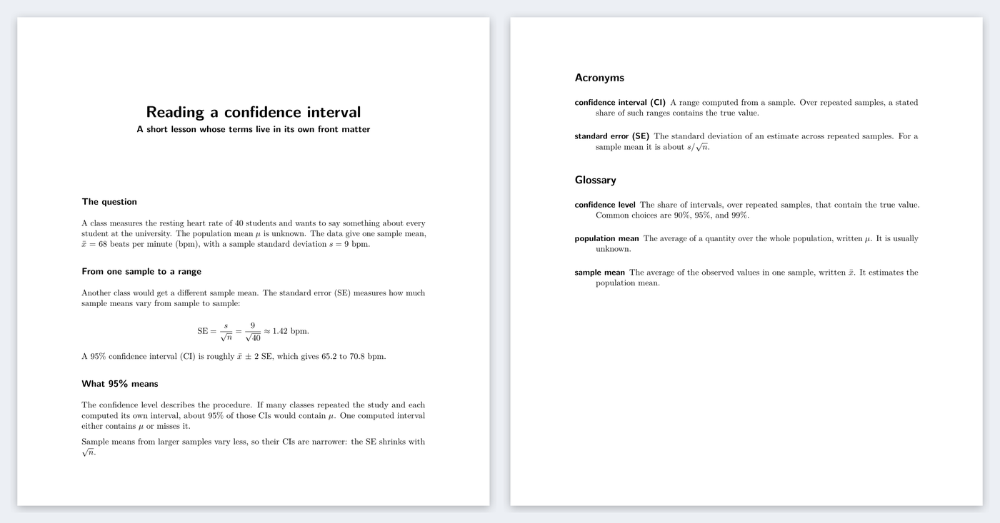

::: {.hero}
# Glossaries for Quarto, the way LaTeX does them {.hero-title}

Write a key in double square brackets. Web readers hover over the term and see
its definition. The PDF gets a real `\gls{key}` from LaTeX's `glossaries`
package. Both come from one vocabulary, written in YAML.

```bash
quarto add brenobeirigo/quarto-glossary
```

[Get started](getting-started.qmd){.btn .btn-primary}
[Ways to define terms](define-terms.qmd){.btn .btn-outline-primary}
[Source on GitHub](https://github.com/brenobeirigo/quarto-glossary){.btn .btn-outline-secondary}
:::

## Try it

Hover over the dotted words, or press <kbd>Tab</kbd> to reach them with the
keyboard.

::: {.demo-grid}
::: {.demo-pane}
[You write]{.demo-label}

```markdown
Agents built on [[llm|plural]] draft text
quickly. A [[controlled-vocabulary]] keeps
an [[llm]] on the terms your field
already uses.
```
:::

::: {.demo-pane .demo-output}
[Readers see]{.demo-label}

Agents built on [[llm|plural]] draft text quickly. A [[controlled-vocabulary]]
keeps an [[llm]] on the terms your field already uses.
:::
:::

The first reference to the acronym printed the long form and the
abbreviation. The second printed the abbreviation alone. That is the
[[first-use]] rule from LaTeX, applied on the web.

## Why I built it

[[latex]] has had the `glossaries` package for years. You define a term
or an acronym once. The first use of an acronym expands it, later uses
abbreviate it, and the list at the end of the document contains exactly the
entries you cited. I needed the same thing in Quarto, for papers, lecture
notes, and course websites, and no extension did all of it. So I wrote this
one.

I also draft with AI agents, and they drift. A few pages in, a model calls one
concept by three names and starts using words like "leverage" and "seamless".
I write mostly for science and education, where a term should mean one thing
and students need to know what that thing is. A glossary file fixes the
vocabulary for the agent and defines it for the reader. The agent writes
`[[key]]`, [[strict-mode]] stops the render when it invents a key, and
students get the definition on hover.

## Define terms where they fit

::: {.panel-tabset}

### In the document

Put the entries in the [[front-matter]]. The document is self-contained: one
`.qmd` file, nothing else to ship.

```yaml
---
title: Reading a confidence interval
filters: [glossary]
glossary:
  entries:
    - id: ci
      kind: acronym
      short: CI
      long: confidence interval
      definition: A range computed from a sample. Over repeated samples, a
        stated share of such ranges contains the true value.
---

A 95% [[ci]] for the mean heart rate is 65.2 to 70.8 bpm.
```

[See a lesson built this way, in HTML and PDF](demos/front-matter.qmd).

### In one file

Keep every term in one [[yaml|short]] file and point each document or the
whole project at it.

```yaml
# _quarto.yml or the document's front matter
filters: [glossary]
glossary:
  path: glossary.yml
```

```yaml
# glossary.yml
entries:
  - id: sample-size
    term: sample size
    symbol: $n$
    definition: The number of units included in an analysis.
```

This manual works this way. Its vocabulary is
[`docs/glossary.yml`](https://github.com/brenobeirigo/quarto-glossary/blob/main/docs/glossary.yml).

### In several files

Split the vocabulary by topic or by course. [[json|short]] works too.

```yaml
glossary:
  path: [statistics.yml, acronyms.yml, course-2026.json]
```

A key defined twice stops the render and names both sources.

### File plus page terms

Share a course vocabulary and add terms that only one lecture needs.

```yaml
glossary:
  path: glossary.yml
  entries:
    - id: bootstrap
      term: bootstrap
      definition: Resampling the data with replacement to estimate
        the variability of a statistic.
```

### Website or book

Set the options once in `_quarto.yml`. Give the lists their own page and every
reference on every page links there.

```yaml
glossary:
  path: glossary.yml
  html-glossary-page: glossary.qmd
```

```markdown
<!-- glossary.qmd -->
::: {.glossary include-unused="true"}
:::
```

See this manual's [Glossary](glossary.qmd) page.
:::

## One source, two outputs

::: {.demo-grid}
::: {.demo-pane}
[HTML]{.demo-label}

::: {.callout-note title="Balloons escape callouts and tables"}
A [[doi]] identifies a dataset, an article, or a report. The balloon is
attached to the page body, so this callout cannot clip it.
:::

| Context | Reference |
|---|---|
| Table cell | [[sample-size]] |
| Another cell | [[metadata]] |
: A caption can define [[reproducible-research]] too.
:::

::: {.demo-pane}
[PDF]{.demo-label}

[{.pdf-shot fig-alt="Two PDF pages. The first holds a short statistics lesson where the standard error and the confidence interval expand on first use. The second holds an Acronyms list with CI and SE and a Glossary list with confidence level, population mean, and sample mean."}](demos/front-matter.pdf)
:::
:::

The PDF uses `glossaries-extra` with the `long-short-desc` acronym style by
default. `makeindex` and `bib2gls` are available for theses and books. Details
are in [LaTeX and PDF output](latex-output.qmd).

## Writing with agents

Add the vocabulary rules to the instructions file your agent reads, such as
`AGENTS.md` or `CLAUDE.md`:

```markdown
## Vocabulary
- Use only the terms defined in glossary.yml. Refer to each one as [[id]].
- Do not paraphrase a defined term or invent a synonym for it.
- If a concept has no entry, stop and propose one (id, term, definition).
- Run `quarto render` before you finish. An unknown key fails the build.
```

When the agent invents a key, the render stops and names it:

```console
glossary: unknown glossary key [[robust-estimator]] in chapter-2.qmd
```

You then decide whether the concept deserves an entry. The full setup is in
[Writing with agents](agents.qmd).

## How it compares

::: {.table-scroll}
| | Quarto Glossary | LaTeX `glossaries-extra` | [quarto-glossary](https://github.com/debruine/quarto-glossary) | [acronyms](https://github.com/rchaput/acronyms) | [glossary (R)](https://github.com/debruine/glossary) |
|---|:-:|:-:|:-:|:-:|:-:|
| Runs in Quarto | ✓ | PDF only, by hand | ✓ | ✓ | ✓ through R |
| Reference syntax | `[[key]]` | `\gls{key}` | `` | `\acr{key}` | `` `r glossary("key")` `` |
| Terms in a YAML or JSON file | ✓ | ✗ | ✓ | ✓ | ✓ |
| Terms in the front matter | ✓ | ✗ | ✗ | ✓ | ✗ |
| Hover definitions on the web | ✓ | ✗ | ✓ | ✗ | ✓ |
| Definition on keyboard focus | ✓ | n/a | not documented | n/a | not documented |
| Generated list | ✓ | ✓ | ✓ | ✓ | ✓ |
| Separate acronym and term lists | ✓ | ✓ | ✗ | acronyms only | ✗ |
| Acronym expands on first use | ✓ | ✓ | ✗ | ✓ | ✗ |
| Plural and capitalized forms | ✓ | ✓ | custom text only | plurals | custom text only |
| Native `glossaries` package in PDF | ✓ | ✓ | ✗ | ✗ | ✗ |
| `makeindex` and `bib2gls` | ✓ | ✓ | ✗ | ✗ | ✗ |
| Unknown key | stops the render | stops the build | empty definition | warning, or error if set | warning |
| Markdown, math, and citations in definitions | ✓ | ✓ (as LaTeX) | plain text | preview branch only | plain text in popups |
| Extra runtime | none | TeX tools | none | none | R |
: Glossary and acronym tools for Quarto, checked against each project's documentation in October 2026. {.compare-table}
:::

[qmd-lab/glossary](https://github.com/qmd-lab/glossary) is left out because it
collects definition blocks into one section and has no in-text references. If
a cell is wrong, [open an issue](https://github.com/brenobeirigo/quarto-glossary/issues)
and I will fix it.

## Lists for this page

The placeholder below prints only the entries this page uses. Acronyms and
terms get separate lists, as in LaTeX.

::: {.glossary level="3"}
:::
